# FitLog · 私人健身训练记录

一套可自托管的全栈健身记录系统：**1,285 个中文动作库（动图 + 肌肉部位图 + 分步讲解）＋ 逐组重量记录 ＋ 按周几自动排课的训练计划 ＋ DeepSeek 生成计划 ＋ 多账号隔离 ＋ 训练动态与留言 ＋ 五种格式导出**。
界面为**黑白单色设计**（Monochrome）：浅色模式黑字白底、深色模式整体反相，全站仅保留一处危险红；移动端优先，手机上可以直接当作 App 使用（支持添加到主屏幕）。

> 打开就知道今天练什么：计划里选好「每周几练哪套」，首页按当天日期自动展示训练内容，一键生成当天训练记录。
> 练完点「完成训练」，可以顺手把这次训练分享到动态，让同系统的家人 / 朋友看见你的组次与容量，并留下评价。


## 界面预览

| 登录（多账号） | 今日（按周几显示当天训练） |
| --- | --- |
| 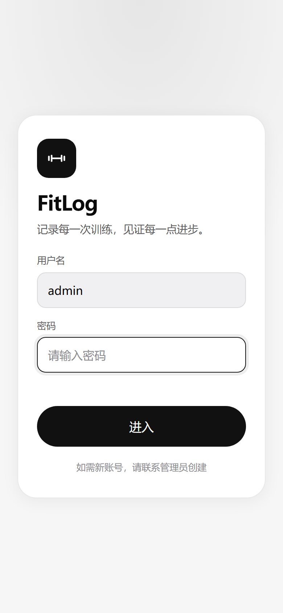 | 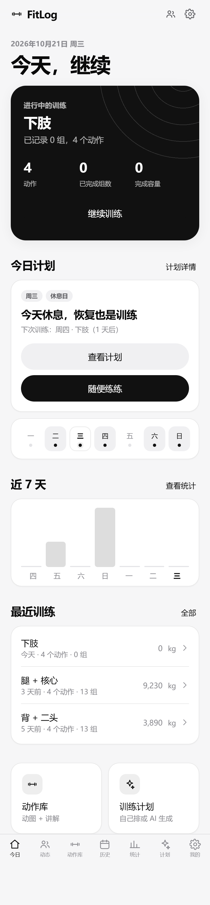 |

| 训练记录（逐组重量 / 完成状态） | 选择动作 |
| --- | --- |
| 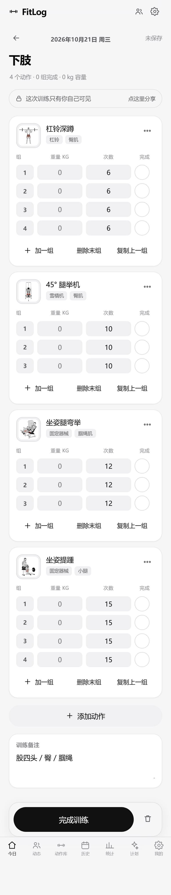 | 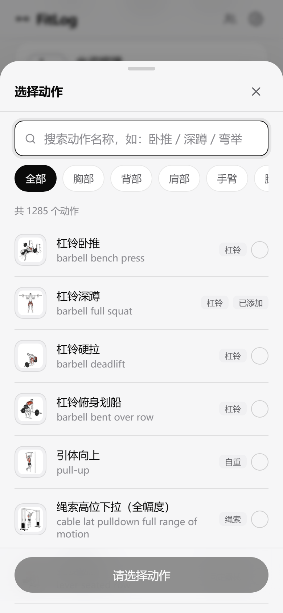 |

| 从动作库选动作 | 动作库（搜索 + 肌群 / 器械筛选） |
| --- | --- |
|  | 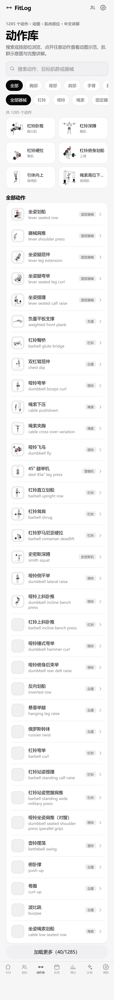 |

动作详情：动图示范 + 正/背面肌肉部位图（高亮主要刺激肌群）+ 准备 / 执行 / 呼吸 / 常见错误 / 组次建议。

| 杠铃卧推（推类） | 深蹲（下肢） |
| --- | --- |
| 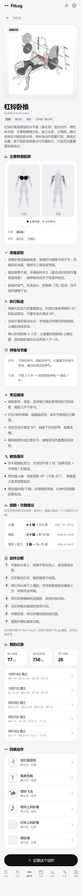 | 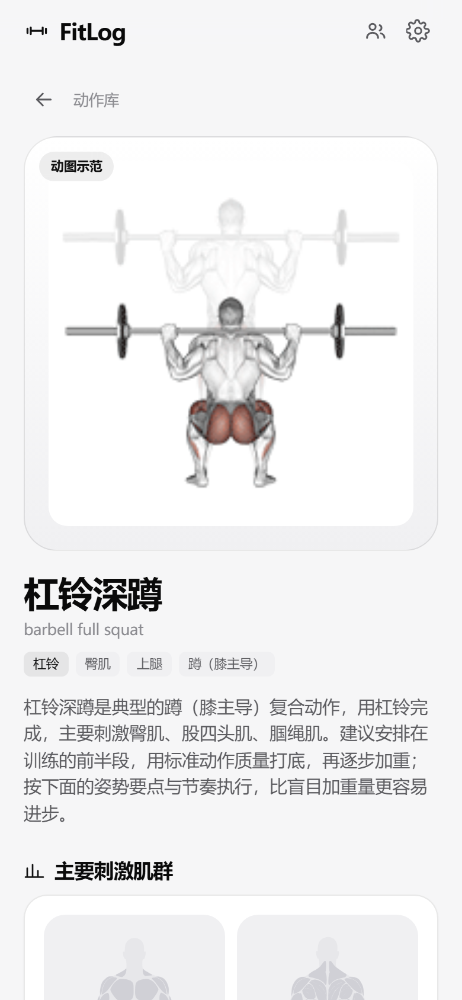 |

| 训练计划列表 | 计划详情（每周安排 + 今天高亮） |
| --- | --- |
|  | 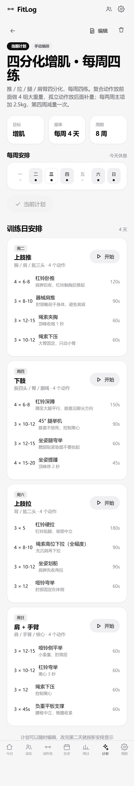 |

| 自己排计划（选周几 + 填动作） | 统计 |
| --- | --- |
| 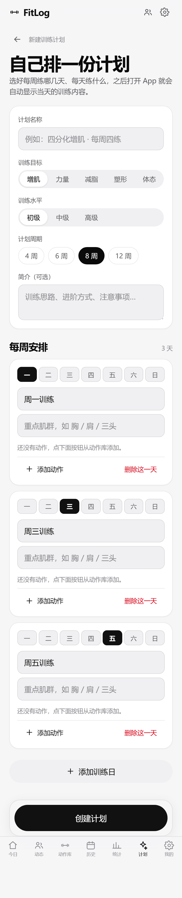 | 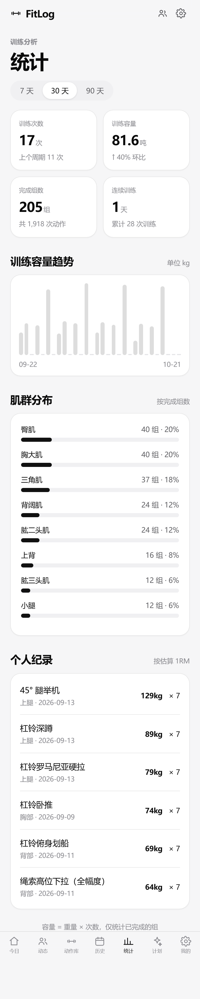 |

| 历史（月历） | 桌面端（深色） |
| --- | --- |
| 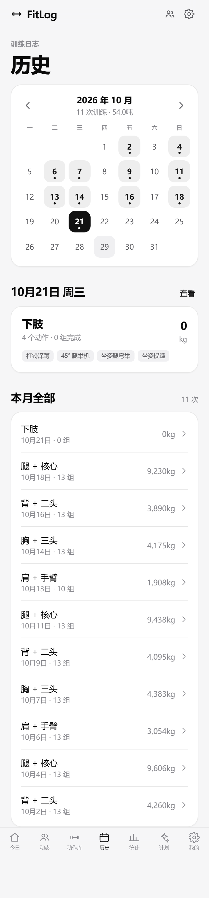 | 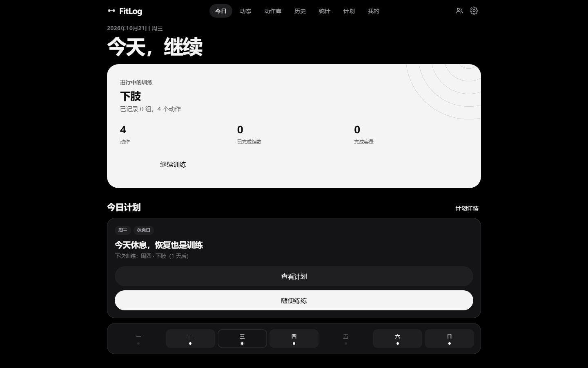 |

训练动态：练完把训练公开出去，别的账号能看到动作、组×次数、总容量，并留言互动。

| 动态列表（全部 / 我分享的） | 动态详情（动作明细 + 留言） |
| --- | --- |
| 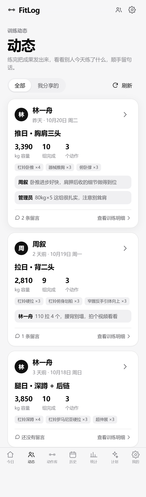 | 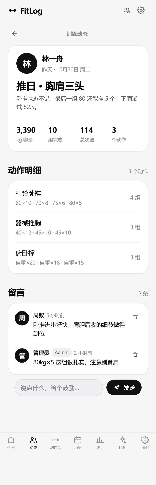 |

深色模式下的动态页：

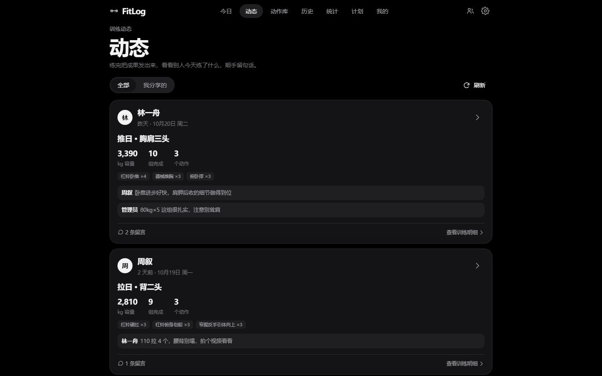

「我的」页面：账号信息、导出面板（5 种格式 + 时间范围）、用户管理入口。

| 我的（浅色） | 我的（深色） |
| --- | --- |
| 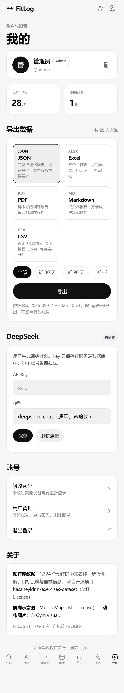 | 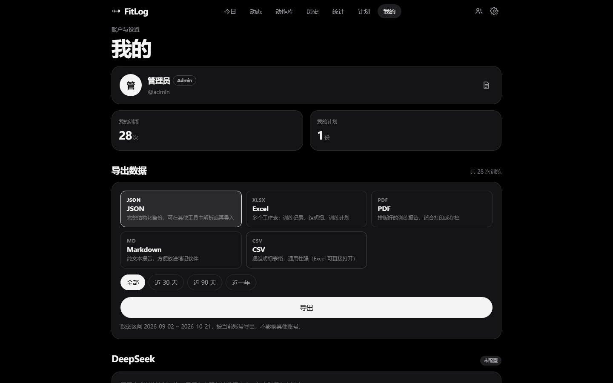 |

深色模式下的动作详情：

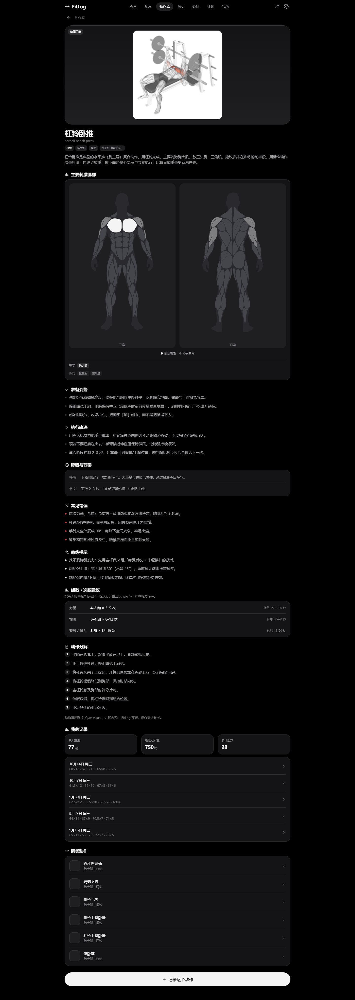

> 截图由 `node scripts/screenshots.mjs` 自动生成（复用本机 Edge，无需下载浏览器内核）。


## 功能

| 模块 | 说明 |
| --- | --- |
| 动作库 | 1,285 个动作：中文名 + 英文名 + 目标肌群 + 协同肌 + 器械 + 分类；中文搜索（含同义词）与肌群 / 器械双维筛选；首屏 6 个带**动图**的大卡片 |
| 动作讲解 | 每个动作都有结构化中文讲解：准备姿势 → 执行轨迹 → 呼吸与节奏 → 常见错误 → 教练提示 → 组数·次数建议（按力量 / 增肌 / 塑形分档）→ 注意事项。内容由「动作模式 + 目标肌群」生成，不同动作讲的重点不一样 |
| 动图与肌肉图 | 每个动作配循环播放的 GIF 示范；人体肌肉图采用开源矢量项目 [MuscleMap](https://github.com/Jsplice/MuscleMap)（MIT），**墨色高亮主要刺激肌群、灰色标注协同肌**，跟随深浅色主题自动反相 |
| 训练记录 | 选动作 → 逐组填重量、次数、完成状态；热身组（W）/ 力竭组（F）标记、复制上一组、动作备注；输入即自动保存 |
| 训练计划 | **自己排**：选每周几、写训练日名称与重点、加动作并填组数 / 次数 / 休息；**或 AI 生成**：填目标、水平、每周天数、可用器械，由 DeepSeek 生成后可直接编辑微调 |
| 按日期显示 | 计划里标了周几的训练日，首页当天自动显示为「今日计划」（动作预览 + 组数与预估时长），休息日显示「下次训练：周四 · 下肢（2 天后）」 |
| 历史 | 月历视图标记训练日，按天查看训练详情，按月汇总容量 |
| 统计 | 训练次数 / 容量 / 组数 / 连续天数、容量趋势柱状图（7 / 30 / 90 天）、肌群分布、个人纪录（估算 1RM） |
| 多账号 | 用户名 + 密码登录（scrypt 加盐哈希、HttpOnly 会话 Cookie）；每个账号的训练、计划、DeepSeek Key 完全隔离；管理员可在「我的 → 用户管理」添加 / 重置 / 删除账号，首个账号自动成为管理员 |
| 训练动态 | 练完点「完成训练」时可选**公开到动态**（也可以事后单独开 / 关分享）；动态流按时间倒序展示所有账号公开的训练：作者、动作标签（`杠铃卧推 ×4`）、总容量 / 组数 / 动作数、最近留言预览。**不分享的训练永远只有自己能看到** |
| 留言 | 任意账号可在公开动态下留言（单条 ≤ 500 字，回车即发）；留言作者、动态作者、管理员可以删除留言；动态主人随时「取消分享」，该训练立刻从所有人视野里消失 |
| 导出 | 一次数据、五种格式：**JSON**（完整备份）、**Excel**（概览 / 训练记录 / 组明细 / 计划 四个工作表）、**PDF**（排版好的报告，内置中文字体）、**Markdown**（丢进笔记软件）、**CSV**（逐组明细）；可选「全部 / 近 30 天 / 近 90 天 / 近一年」 |
| 数据 | 全部数据存于本地 SQLite（WAL），按用户隔离 |
| 部署 | `install.sh` 一键脚本：菜单式安装 / 更新 / 状态 / 重启 / 备份 / 日志 / 卸载，自动生成 `.env` 随机密码、写 systemd 服务（无 systemd 时退化为 nohup）、装完做健康检查 |
| 小程序 | 同仓库外的 `fitlog-mp/` 是原生微信小程序端，连同一个后端：相同的动态流、留言、完成即分享，`tools/lint.mjs` + `tools/smoke.mjs` 自检 |


## 日常动线

1. **先建计划**（只需一次）：`计划 → 自己创建计划` → 选周几（如 二 / 四 / 六 / 日）→ 填每天的动作与组次 → 创建 → 设为当前计划。
2. **每天打开**：首页直接显示今天该练哪天；点「开始今天的训练」，系统按计划生成当天训练记录（动作、组数、上次重量都已预填）。
3. **边练边记**：每组填重量与次数，点右侧圆形按钮标记完成；组号可切换成热身组 / 力竭组。
4. **看进度**：`统计` 看容量趋势、肌群分布、个人纪录；`历史` 按月回看。
5. **练完分享**：训练页点「完成训练」→ 开关打开「分享到动态」→ 确认后跳到 `动态`；别人点进你的动态能看到每组重量与次数并留言，你会在动态列表直接看到预览。
6. **不按计划的日子**：首页「不按计划，自由训练」直接从动作库挑动作练。


## 技术栈

- **前端**：原生 ES Module + 手写 CSS 设计系统（零构建、零运行时依赖，首屏极快）
- **后端**：Node.js 22 + Express 5
- **数据库**：SQLite（better-sqlite3，WAL 模式）
- **AI**：DeepSeek Chat API（服务端代理调用，Key 不出服务器）

```
fitlog/
├── server/                    # 后端
│   ├── index.js               # 应用入口、路由挂载、静态资源
│   ├── db.js                  # 数据库结构、多用户迁移、动作库导入
│   ├── auth.js                # 会话、登录态中间件、注册策略、账号增删
│   ├── password.js            # scrypt 密码哈希与校验（零依赖）
│   ├── deepseek.js            # DeepSeek 调用封装（按账号取 Key）
│   ├── exercise-guide.js      # 动作讲解生成（15 种动作模式 + 组次建议）
│   ├── report.js              # 导出数据装配 + JSON/CSV/MD/XLSX/PDF 渲染
│   ├── xlsx.js                # 零依赖 XLSX 生成器（zip + SpreadsheetML）
│   └── routes/                # auth / users / exercises / workouts / stats / plans / settings / export / feed
├── public/                    # 前端（无构建步骤）
│   ├── index.html
│   ├── css/app.css            # 设计系统（含深浅色、动图、肌肉图、计划编辑器）
│   ├── js/
│   │   ├── app.js             # hash 路由 + 7 个底部标签
│   │   ├── api.js  core.js    # 接口封装 / UI 原子件
│   │   ├── muscle-map.js      # 动作 → 肌群映射 + 肌肉图渲染
│   │   ├── vendor/musclemap.js # MuscleMap 人体矢量路径数据（MIT，见文件头署名）
│   │   ├── picker.js          # 通用动作选择器（记录页与计划编辑器共用）
│   │   └── views/             # home / log / exercises / exercise-detail / feed / post /
│   │                          # plans / plan-detail / plan-editor / history / stats / me
│   └── media/
│       ├── thumbs/            # 动作缩略图 180×180（12 MB）
│       └── gifs/              # 动作动图（1,285 个，122 MB）
├── scripts/
│   ├── build-data.mjs         # 原始数据集 → 中文动作库（人工校对名、去重、搜索别名）
│   ├── fetch-media.mjs        # 下载动作缩略图 / 动图
│   ├── screenshots.mjs        # 生成 README 截图（需要 playwright）
│   ├── seed-demo.mjs          # 生成演示数据（训练记录 + 一份四分化计划）
│   ├── seed-social-demo.mjs   # 生成 / 清理「动态 + 留言」演示账号（demo_lin / demo_zhou）
│   ├── smoke-social.mjs       # 动态与留言的接口冒烟（分享可见性、越权 404、留言权限）
│   ├── e2e-social.mjs         # 双账号浏览器 E2E（Playwright + 本机 Edge）
│   ├── reset-data.mjs         # 清空训练 / 计划 / 配置（保留动作库）
│   └── fetch-font.mjs         # 补齐 PDF 导出用的中文字体
├── install.sh                 # 一键安装 / 更新 / 备份 / 卸载（带菜单）
├── assets/fonts/              # PDF 导出用的 Noto Sans SC（SIL OFL，11 MB）
├── data/
│   ├── exercises.json         # 构建产物：动作库
│   └── fitlog.db              # SQLite 数据库（运行时生成）
├── Dockerfile
└── docker-compose.yml
```


## 快速开始

### 方式一：一键脚本（推荐，Linux / macOS / WSL）

```bash
git clone https://github.com/tuohai24/fitlog.git
cd fitlog
bash install.sh
```

回车就是一个交互菜单（不带参数直接运行）：

```
FitLog 管理菜单   /opt/fitlog
────────────────────────────────────────
  1) 安装 / 首次部署
  2) 更新到最新版本
  3) 查看运行状态
  4) 重启服务
  5) 备份数据
  6) 查看日志
  7) 卸载
  0) 退出
```

- **安装**：检查 Node ≥ 20（含 20.6 的 `--env-file` 支持）→ `npm install --omit=dev` → 没有 `.env` 就用 `openssl` 生成随机管理员密码并写成 `chmod 600` → 有 systemd 就装成 `fitlog.service` 并 `enable --now`，没有就 `nohup` 后台跑并写 `.fitlog.pid` → 轮询 `/api/health` 最多 20 秒，最后打印访问地址与密码。
- **更新**：`git pull --ff-only` → 依赖有变化才重装 → 重启 → 健康检查；`.env` 与 `data/fitlog.db` 不动。
- **状态**：systemd / 进程状态 + `/api/health` 健康检查 + 数据库体积 + 只读查库统计「账号 / 训练 / 动态 / 留言」条数。
- **备份**：把 `data/` 与 `.env` 打成 `backups/fitlog-backup-YYYYmmdd-HHMMSS.tar.gz`（WAL 已落盘，可直接打包）。
- **日志**：systemd 走 `journalctl -u fitlog`，nohup 模式读 `data/fitlog.log`，取最近 60 行。
- **卸载**：默认**只停服务、保留数据**，加 `--purge` 才连库一起删。

也能直接给子命令（适合脚本 / 不交互）：

```bash
bash install.sh install     # 安装并启动
bash install.sh update      # 拉取新版本并重启
bash install.sh status      # 运行状态
bash install.sh restart     # 重启
bash install.sh backup      # 备份
bash install.sh log         # 最近 60 行日志
bash install.sh uninstall   # 卸载（默认保留数据）
bash install.sh uninstall --purge --yes   # 连数据一起删，不确认
```

> 可用环境变量：`FITLOG_DIR`（安装目录，默认脚本所在目录）、`PORT`、`ADMIN_USERNAME`、`ADMIN_PASSWORD`。
> 例：`PORT=9000 ADMIN_PASSWORD='换个强密码' bash install.sh install --yes`

### 方式二：直接跑（需 Node.js ≥ 20）

```bash
git clone https://github.com/tuohai24/fitlog.git
cd fitlog
npm install
cp .env.example .env          # 至少修改 ADMIN_PASSWORD
node --env-file=.env server/index.js
```

打开 `http://服务器IP:8080`，用初始管理员账号登录（用户名 `ADMIN_USERNAME`，默认 `admin`；密码 `ADMIN_PASSWORD`，未设置时回退到 `APP_PASSWORD`）。

> **首次启动会自动建库**：创建管理员账号，并把旧版本的单用户数据（训练 / 计划 / DeepSeek 配置）全部划归到该账号；旧登录状态会失效，重新登录一次即可。

> **想先看效果？** 数据库文件不入库（`data/fitlog.db` 在 `.gitignore` 里），首次启动是一个干净的库。执行 `npm run seed:demo` 会灌入约 7 周示例训练和一份「四分化增肌 · 每周四练」计划（周二推 / 周四腿 / 周六拉 / 周日肩臂），截图就是用它跑出来的。
> 再执行 `npm run seed:social` 会额外建两个演示账号（`demo_lin` / `demo_zhou`，密码 `demo1234`）并生成 3 条已公开的训练与几条留言，动态页立刻就有内容；不想要了执行 `node scripts/seed-social-demo.mjs --clean`。
> 正式使用前执行 `npm run reset -- --yes` 清空训练记录 / 计划 / AI 配置，动作库与账号会保留。

### 方式三：Docker（推荐部署到服务器）

```bash
cd fitlog
cp .env.example .env
docker compose up -d --build
```

数据持久化在 `./data-store/fitlog.db`，重启 / 升级镜像不会丢数据。

### 方式四：PM2 常驻

```bash
npm install
npm i -g pm2
ADMIN_PASSWORD='你的密码' ADMIN_USERNAME='admin' pm2 start server/index.js --name fitlog
pm2 save && pm2 startup
```


## 环境变量

| 变量 | 默认值 | 说明 |
| --- | --- | --- |
| `ADMIN_USERNAME` | `admin` | 初始管理员用户名（仅首次建库时生效） |
| `ADMIN_PASSWORD` | 空 → 回退 `APP_PASSWORD` | 初始管理员密码，**部署到公网必须修改** |
| `APP_PASSWORD` | `fitlog` | 旧版单用户密码，兼容保留：没设 `ADMIN_PASSWORD` 时作为管理员初始密码 |
| `SIGNUP_CODE` | 空 | 开放注册的邀请码；留空 = 关闭注册，只能由管理员添加账号 |
| `PORT` | `8080` | 监听端口 |
| `HOST` | `0.0.0.0` | 监听地址 |
| `DATA_DIR` | `./data` | SQLite 数据库所在目录 |
| `DEEPSEEK_API_KEY` | 空 | DeepSeek Key，也可在 App「我的」页面按账号填写（界面优先级更高） |
| `DEEPSEEK_MODEL` | `deepseek-chat` | 可改为 `deepseek-reasoner` |
| `PDF_FONT_PATH` | `assets/fonts/NotoSansSC-Regular.ttf` | PDF 导出用的中文字体；缺字体时执行 `npm run fetch:font` |
| `TZ` | 系统时区 | 影响「今天」的判断，建议 `Asia/Shanghai` |

> DeepSeek Key 获取：https://platform.deepseek.com/api_keys


## API 一览

所有 `/api/*`（除登录外）均需登录态 Cookie。

| 方法 | 路径 | 说明 |
| --- | --- | --- |
| GET | `/api/auth/status` | 是否已登录 + 系统里有没有账号 + 能否注册 |
| POST | `/api/auth/login` | `{username, password}` 登录，写入 HttpOnly Cookie |
| POST | `/api/auth/register` | 注册（首个账号或带邀请码时可用） |
| POST | `/api/auth/logout` | 退出登录 |
| POST | `/api/auth/password` | 修改自己的密码（其他设备会话失效） |
| PATCH | `/api/auth/profile` | 修改昵称 |
| GET/POST | `/api/users` | 用户列表 / 新建账号（管理员） |
| POST | `/api/users/:id/password` | 重置他人密码（管理员） |
| DELETE | `/api/users/:id` | 删除账号及其全部数据（管理员） |
| GET | `/api/export/formats` | 可用导出格式 + 数据区间 |
| GET | `/api/export?format=json\|xlsx\|pdf\|md\|csv&from=&to=&scope=` | **导出当前账号数据** |
| GET | `/api/exercises?q=&cat=&equip=&target=&page=&pageSize=` | 动作搜索 / 列表 |
| GET | `/api/exercises/meta` | 肌群、器械、分类聚合 |
| GET | `/api/exercises/:id` | 动作详情：中文步骤 + 结构化讲解 + 肌肉部位 + 同类动作 + 是否有动图 |
| GET | `/api/exercises/:id/history` | 该动作历史记录与个人最佳 |
| GET | `/api/workouts?from=&to=&limit=` | 训练列表（带容量聚合） |
| GET | `/api/workouts/today` | 今日训练 |
| GET | `/api/workouts/:id` | 单次训练（含动作与每组数据） |
| POST / PUT / DELETE | `/api/workouts(/:id)` | 新建 / 整份更新 / 删除 |
| POST | `/api/workouts/:id/finish` | **完成训练** `{share: true\|false}`：写完成时间，并决定是否公开到动态 |
| PATCH | `/api/workouts/:id/share` | 单独开关分享 `{shared: true\|false}`（改完立刻从动态里出现 / 消失） |
| POST | `/api/workouts/from-plan` | 由计划的某一天生成当天训练 |
| GET | `/api/feed?limit=&before=&scope=all\|mine` | **训练动态流**：所有账号公开的训练（含作者、容量/组数/动作数、动作标签、留言数与最近 2 条留言），游标分页 |
| GET | `/api/feed/:id` | **动态详情**：完整动作与每组重量次数 + 全部留言 + `isMine` / `shared` |
| POST | `/api/feed/:id/comments` | 发表留言 `{content}`（≤ 500 字） |
| DELETE | `/api/feed/comments/:cid` | 删除留言（留言作者 / 动态作者 / 管理员） |
| GET | `/api/plans` · `/api/plans/:id` | 计划列表 / 详情（含 `weekdays` 与今天对应第几天） |
| GET | `/api/plans/today?date=YYYY-MM-DD` | **按日期返回今天的训练日**，无则返回下一个训练日 |
| POST | `/api/plans` · PUT `/api/plans/:id` | 手动创建 / 编辑计划（`days[].weekday` 指定周几，1=周一…7=周日） |
| DELETE | `/api/plans/:id` | 删除计划 |
| POST | `/api/plans/generate` | DeepSeek 生成计划 |
| POST | `/api/plans/:id/activate` | 设为当前计划 |
| GET | `/api/stats/overview?days=` | 概览（含环比、连续天数） |
| GET | `/api/stats/daily?days=` | 每日容量序列 |
| GET | `/api/stats/muscles?days=` | 肌群分布 |
| GET | `/api/stats/prs` | 个人纪录（估算 1RM） |
| GET/PUT | `/api/settings` | 读取 / 保存当前账号的 DeepSeek 配置 |

`GET /api/plans/today` 返回示例：

```json
{
  "date": "2026-10-20",
  "weekday": 2,
  "weekdayLabel": "周二",
  "plan": { "id": 5, "title": "四分化增肌 · 每周四练", "active": 1 },
  "dayIndex": 0,
  "day": { "name": "上肢推", "focus": "胸 / 肩 / 肱三头", "exercises": [{ "name": "杠铃卧推", "sets": 4, "reps": "6-8", "rest": "120s" }] },
  "next": { "weekdayLabel": "周四", "name": "下肢", "inDays": 2 },
  "week": [{ "label": "一", "name": null, "isToday": false }, { "label": "二", "name": "上肢推", "isToday": true }]
}
```

### 数据结构

```
users (账号: username / scrypt 密码哈希 / is_admin)
  └──< workouts (训练, user_id, shared / shared_at / finished_at)
        └──< workout_exercises ──< sets (weight / reps / done / kind)
        └──< workout_comments (留言, user_id, content)
  └──< plans (训练计划, user_id, content 为 JSON: days[].{ weekday, name, focus, exercises[] })
  └──< settings (按账号的配置, 主键 (user_id, key))
  └──< sessions (登录会话, token / user_id / 过期时间)

exercises (动作库，全局共享)
```

所有业务查询都带 `user_id` 条件，跨账号读写会直接返回 404；删除账号时级联删除其训练、计划、配置与会话。
**唯一的跨账号读入口是动态**：`GET /api/feed*` 只认 `shared = 1` 的训练，其余接口照旧按 `user_id` 硬隔离——同一条训练，作者用 `/api/workouts/:id` 能读，别人只能走 `/api/feed/:id`，且只在你分享期间可读。


## 关于动作库

- **数据来源**：开源项目 [hasaneyldrm/exercises-dataset](https://github.com/hasaneyldrm/exercises-dataset)（MIT）。
  本项目在其基础上做了：中英文名称对齐与人工校对、机位 / 性别 / 版本变体去重（1,324 → 1,285）、中文同义词搜索别名、核心动作排序权重。
- **讲解**：上游只有英文操作步骤。`server/exercise-guide.js` 依据动作名称判定动作模式（深蹲 / 硬拉 / 水平推 / 垂直拉 / 弯举 / 侧平举 … 共 15 类），再结合目标肌群与器械，生成针对性的准备姿势、执行轨迹、呼吸节奏、常见错误、教练提示与组数建议；复合动作与孤立动作的组次推荐不同，力量 / 增肌 / 塑形三档目标各有一套参数。
- **动图**：`public/media/gifs/`，1,285 个 GIF 共 122 MB，已随项目下载到本地；若该目录为空，执行 `npm run fetch:gifs` 一键补齐（约 5–10 分钟）。
- **肌肉部位图**：矢量数据来自开源项目 [MuscleMap](https://github.com/Jsplice/MuscleMap)（MIT License，Inkscape 手绘人体正/背面肌肉路径），本地渲染见 `public/js/vendor/musclemap.js`；`public/js/muscle-map.js` 负责把动作的目标/协同肌群映射到肌肉表面，主动肌实心高亮、协同肌 42% 透明度，配色全部走 CSS 变量、深浅色自动反相。
- **版权**：动作图片与动图 © [Gym visual](https://gymvisual.com/)，按其要求以 180×180 分辨率使用并保留署名，仅随本项目本地展示使用。若要商用或二次分发，请自行确认 Gym visual 的授权条款。


## 反向代理（可选，建议加 HTTPS）

```nginx
server {
    listen 443 ssl http2;
    server_name fitlog.example.com;

    ssl_certificate     /etc/letsencrypt/live/fitlog.example.com/fullchain.pem;
    ssl_certificate_key /etc/letsencrypt/live/fitlog.example.com/privkey.pem;

    location / {
        proxy_pass http://127.0.0.1:8080;
        proxy_set_header Host $host;
        proxy_set_header X-Forwarded-Proto $scheme;
        proxy_set_header X-Forwarded-For $proxy_add_x_forwarded_for;
        proxy_read_timeout 300s;   # AI 生成计划可能较慢
    }

    # 动图较多，静态资源交给 nginx 直接读文件更快
    location /media/ {
        alias /srv/fitlog/public/media/;
        expires 30d;
        access_log off;
    }
}
```


## 导出

「我的 → 导出数据」里选格式与时间范围，下载的文件只包含**当前账号**的数据。

| 格式 | 内容 | 适合 |
| --- | --- | --- |
| JSON | 账号、区间、汇总、每次训练（动作 + 每组重量/次数/完成状态）、计划全文 | 备份、再导入、自己写脚本分析 |
| Excel | 4 个工作表：概览 / 训练记录（每次一行）/ 组明细（每组一行）/ 训练计划 | 在 Excel / WPS / Numbers 里做透视、画图 |
| PDF | A4 报告：概览四格 + 按时间排列的训练表格 + 计划清单，页脚带页码 | 打印、发给教练、存档 |
| Markdown | 带表格的纯文本报告 | Obsidian / Notion / 博客 |
| CSV | 逐组扁平面板（日期、动作、组序、重量、次数、完成、备注…），带 UTF-8 BOM | 导入其他训练软件 / Pandas |

- 时间范围：全部 / 近 30 天 / 近 90 天 / 近一年（API 也可用 `from` / `to` 指定任意区间）。
- 样例文件：`docs/samples/` 下有一份用演示数据导出的 [PDF](docs/samples/fitlog-export.pdf) / [Excel](docs/samples/fitlog-export.xlsx) / [Markdown](docs/samples/fitlog-export.md) / [CSV](docs/samples/fitlog-export.csv) / [JSON](docs/samples/fitlog-export.json)。
- 实现：`server/report.js` 统一装配数据后按格式渲染；Excel 由 `server/xlsx.js` 直接生成 OOXML（零依赖，不引入 SheetJS）；PDF 用 `pdfkit` + 内置 Noto Sans SC 字体，中文不会乱码。
- 字体：`assets/fonts/NotoSansSC-Regular.ttf`（SIL OFL 1.1）。若被清理，执行 `npm run fetch:font`，或用 `PDF_FONT_PATH` 指向系统里的中文字体。

## 多账号

- **登录**：用户名 + 密码。密码用 `scrypt`（随机盐，16 MB 内存参数）哈希后存库，会话是 HttpOnly Cookie（`SameSite=Lax`），默认 60 天有效。
- **首次启动**：自动创建管理员（`ADMIN_USERNAME` / `ADMIN_PASSWORD`），并把老版本数据划归给该账号；此时若还没有任何账号，登录页会直接引导「创建管理员账号」。
- **添加账号**：
  - 管理员在「我的 → 用户管理 → 添加账号」里直接建，可勾选「设为管理员」；
  - 或者部署时设置 `SIGNUP_CODE=邀请码`，让对方在登录页「注册」里填码自助注册。
- **数据隔离**：训练、计划、DeepSeek Key、导出全部按 `user_id` 隔离；越权访问他人的训练 / 计划直接 404。**唯一例外是主动分享出去的训练**（见上一节「训练动态与留言」）。
- **账号管理**：管理员可重置他人密码（会踢掉其所有会话）、删除账号（连同其训练、计划、配置一起删除，不可恢复）。当前登录的账号不能删除自己，系统始终保留至少一个管理员。
- **改密码 / 改昵称**：任意账号可在「我的」里自助操作，改密码后其他设备需重新登录。


## 训练动态与留言

训练默认**私有**。「完成训练」时打开「分享到动态」，这次训练才对其他账号可见；之后随时能在动态详情里「取消分享」。

- **谁能看到**：同系统里的任意账号（= 你愿意共享的人）。没有公开广场，也不需要额外开账号体系。
- **能看到什么**：动态里有作者、日期、训练标题与备注、总容量 / 完成组数 / 总次数 / 动作数，点进详情是**每个动作的每一组** `60×10 · 70×8 · 75×6`；和训练记录页一致，只是只读。
- **留言**：任意账号都能留言（≤ 500 字，回车即发）。删除权限三级：**留言作者**本人、**动态作者**（可以管理自己动态下的留言）、**管理员**。
- **取消分享即刻失效**：`shared` 一变 0，`/api/feed/:id` 立即 404，别人刷新就看不到了；已经产生的留言会随训练一起保留在库里，重新分享又会出现。
- **越权一律 404**：读别人的未分享训练、改别人的分享状态，返回的都是 404（不区分「不存在」和「没权限」，避免探测）。
- **实现**：没有另建一张「帖子表」——动态就是 `workouts` 上的一个视图（`shared = 1`），所以不存在训练与动态两份数据要走同步；留言单独一张 `workout_comments`，跟着训练级联删除。
- **两端一致**：网页与微信小程序调用的是同一组接口（`/api/feed*`、`/workouts/:id/finish`、`/workouts/:id/share`），业务规则只写了一遍。

自测：

```bash
node --env-file=.env scripts/smoke-social.mjs   # 接口冒烟：分享可见性 / 越权 404 / 留言权限（31 项）
node --env-file=.env scripts/e2e-social.mjs     # 双账号浏览器 E2E：完成→分享→他人可见→留言→删除→取消分享（22 项）
```


## 备份与迁移

- 直接复制 `data/fitlog.db`（或 Docker 的 `data-store/fitlog.db`）即为**全部账号**的完整备份。
- 只想备份某个账号：用该账号登录 →「我的 → 导出数据」，选 JSON。
- 迁移服务器：把 `fitlog.db` 放到新机器的 `DATA_DIR` 即可，动作库会随代码一起带过去；账号密码随库一起迁移，无需重新创建。


## 常见问题

**Q：忘记密码？**
- 其他账号还在：让管理员在「我的 → 用户管理」里点该账号的刷新图标重置密码。
- 连管理员密码也忘了：先备份 `data/fitlog.db`，停掉服务，然后在项目目录执行一次性脚本重设（用户名改成你自己的）：

```bash
node -e "import('./server/db.js').then(async ({db})=>{const {hashPassword}=await import('./server/password.js');db.prepare('UPDATE users SET password_hash=? WHERE username=?').run(hashPassword('新密码'),'admin');console.log('done')})"
```

**Q：怎么关闭注册？**
不要把 `SIGNUP_CODE` 写进 `.env` 即可（默认关闭），新账号只能由管理员在「用户管理」里创建。

**Q：AI 生成失败？**
先在「我的」页点「测试连接」。常见原因：Key 错误、余额不足、模型名不符。生成接口超时为 4 分钟，Nginx 需同步放宽 `proxy_read_timeout`。

**Q：想让 AI 计划跑通但暂时没有 Key？**
自己起一个返回固定 JSON 的本地服务（任何 HTTP 服务都行），把「我的 → API 地址」临时指向它即可验证完整链路。

**Q：动图不显示？**
确认 `public/media/gifs/` 有文件；为空时执行 `npm run fetch:gifs`。接口会返回 `hasGif: false`，页面自动降级为静态缩略图。

**Q：手机上怎么像 App 一样用？**
iOS Safari「分享 → 添加到主屏幕」，Android Chrome「菜单 → 添加到主屏幕」。已配置 PWA manifest 与主题色。

**Q：能否多人使用？**
可以。管理员在「用户管理」里给家人 / 朋友各建一个账号，或设置 `SIGNUP_CODE` 让他们自助注册；每个账号的数据完全隔离，互不可见。

**Q：怎么让别人看到我今天的训练？**
训练页点「完成训练」，弹层里把「分享到动态」打开（已经完成的训练，也可以在动态详情页点「分享出去」）。之后所有账号的「动态」里都能看到这次训练的动作与每组数据，并留言。不想被看了就点「取消分享」，立刻失效。

**Q：别人的留言我能删吗？**
自己的留言随时能删；作为动态作者，你也能删别人在你动态下的留言（防止刷屏）；管理员可以删任何留言。三种身份之外的人看不到删除按钮，接口也会返回 403。

**Q：小程序和网页是同一套数据吗？**
是。`fitlog-mp/` 只是另一种客户端，接口地址填同一个后端即可：网页走 HttpOnly Cookie，小程序走 `Authorization: Bearer`，共用同一张 `sessions` 表和同一份数据，手机上分享的训练在网页端也能看到。

**Q：PDF 导出报「缺少中文 PDF 字体」？**
执行 `npm run fetch:font` 重新拉取字体，或设置 `PDF_FONT_PATH` 指向服务器上已有的中文字体（`.ttf` / `.otf`）。


## License

代码 MIT。动作数据遵循上游 MIT；动作图片与动图版权归 Gym visual。
